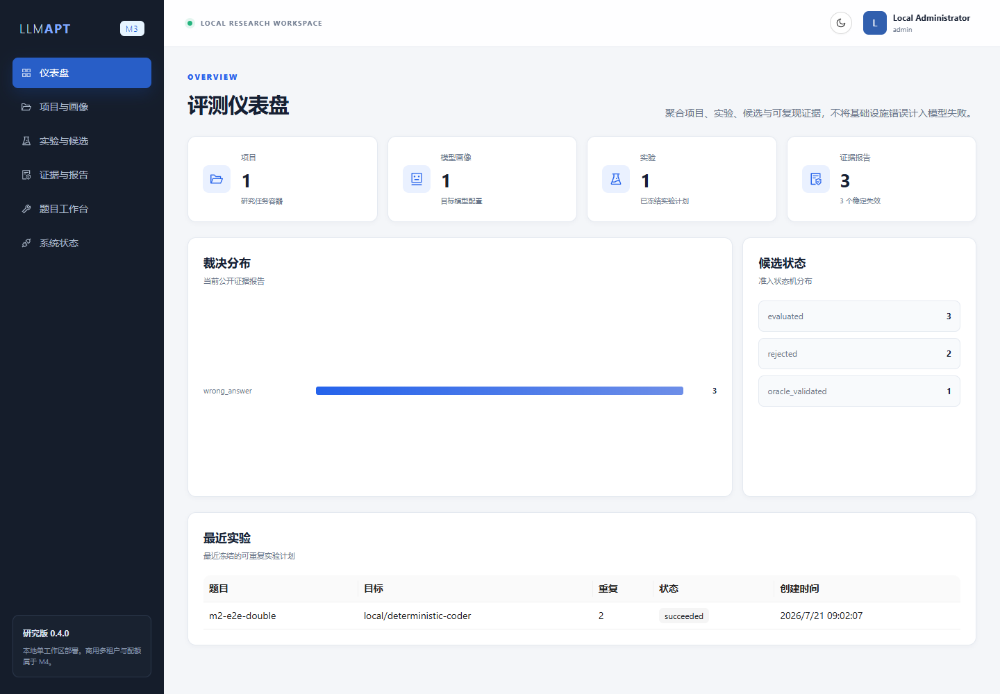

# LLM-APT

LLM-APT（Large Language Model Adversarial Programming Toolkit）是一个用于发现大型语言模型编程能力边界的可复现评测工具链。系统把模型生成的代码视为不可信输入，通过题目变异、可信 Oracle、隔离执行、重复实验和反例归约，将“模型答错了”转化为可复核、可导出的工程证据。

当前版本为 **0.4.0 Research Preview（M0-M3）**。它适合本地研究、课程展示和二次开发；多租户、计费、SLA、gVisor/Firecracker 级逐任务隔离等 M4 商用部署能力尚未实现。仓库采用 Apache License 2.0 开源，许可证本身允许商业使用，但当前软件不承诺生产环境安全性或服务等级。



## 能做什么

- 用统一 JSON Schema 校验程序设计题目、测试用例和资源限制。
- 对种子题目执行可追踪的边界、约束和测试顺序变异。
- 通过可信 Oracle 验证候选题目，避免把错误题目当作模型失败。
- 调用本地确定性 Provider 或 OpenAI-compatible 模型 API 生成候选程序。
- 在无外网、非 root、资源受限的独立 Runner 容器中编译并运行 C++20 代码。
- 进行重复实验，区分稳定失败与偶发失败，并归约最小反例。
- 管理研究项目、模型画像、实验记录和证据报告，导出 JSON、Markdown 或 CSV。
- 提供管理员登录和短时游客会话。游客只能使用安全演示与自己的临时项目，不能调用外部模型或可信执行链路。

## 架构

```text
React Web :3000
       |
FastAPI Control Plane :8000 ---- PostgreSQL / Redis / RabbitMQ / MinIO
       |                                  |
       +---- Celery Worker ---------------+
       |
       +---- internal network ---- C++ Runner
       |
       +---- optional HTTPS ---- OpenAI-compatible model API
```

详细设计见 [architecture.md](docs/architecture.md)，里程碑边界见 [roadmap.md](docs/roadmap.md)。

## 最简单的启动方式：Docker Desktop

### 前置条件

- Windows 10/11、macOS 或 Linux；
- Docker Desktop 4.x（Windows 建议启用 WSL 2 backend）；
- Git；
- 至少 4 核 CPU、8 GB 内存和约 8 GB 可用磁盘空间。

仅使用 Docker 启动时，不需要在宿主机安装 Python、Node.js、PostgreSQL 或 C++ 编译器。

### 1. 获取源码

```bash
git clone https://github.com/YSLee6429/LLM-APT.git
cd llm-apt
```

如果使用本地提交包，直接解压并在终端进入包含 `compose.yaml` 的目录。

### 2. 生成本地配置

Windows PowerShell：

```powershell
powershell -NoProfile -ExecutionPolicy Bypass -File .\scripts\setup-local.ps1
```

Linux、macOS 或 WSL：

```bash
./scripts/setup-local.sh
```

脚本会生成被 Git 忽略的 `.env`，并为数据库、Runner、登录令牌和管理员账号生成随机凭据。不要提交或分享 `.env`。

查看管理员用户名和密码：

```powershell
Select-String -Path .env -Pattern 'LLMAPT_BOOTSTRAP_ADMIN_(USERNAME|PASSWORD)'
```

```bash
grep 'LLMAPT_BOOTSTRAP_ADMIN_\(USERNAME\|PASSWORD\)' .env
```

### 3. 构建并启动

```bash
docker compose up -d --build
docker compose ps
```

首次构建通常需要数分钟。`docker compose ps` 中的 8 个服务均应为 `running` 或 `healthy`。

### 4. 访问

- Web 工作区：<http://localhost:3000>
- API 文档：<http://localhost:8000/docs>
- 就绪检查：<http://localhost:8000/health/ready>

使用 `.env` 中的管理员账号登录。游客会话后端接口为 `POST /api/v1/auth/guest`；游客登录按钮将在下一轮前端交互调整中接入。

### 5. 停止

```bash
docker compose down
```

保留数据重新启动不会丢失项目和报告。若明确要删除所有本地数据，可执行 `docker compose down -v`；该命令不可恢复。

## 管理员密码

首次启动前可直接修改 `.env` 中的 `LLMAPT_BOOTSTRAP_ADMIN_PASSWORD`。数据库已初始化后，使用 API 修改密码：

```bash
curl -X POST http://localhost:8000/api/v1/auth/change-password \
  -H "Authorization: Bearer <登录后获得的令牌>" \
  -H "Content-Type: application/json" \
  -d '{"current_password":"<旧密码>","new_password":"<至少12位的新密码>"}'
```

修改成功后，应同时妥善记录新密码。`.env` 中的 bootstrap 密码只在管理员账号尚不存在时使用，不会覆盖数据库中的已有密码。

## 配置真实模型 API

外部调用默认关闭，项目在没有 API Key 时也能完成离线验收。要接入 OpenAI-compatible HTTPS 接口，在 `.env` 中设置：

```dotenv
LLMAPT_EXTERNAL_MODEL_CALLS_ENABLED=true
LLMAPT_MODEL_PROVIDER_KEY=external
LLMAPT_MODEL_PROVIDER_NAME=openai-compatible
LLMAPT_MODEL_NAME=<模型名称>
LLMAPT_MODEL_REVISION=<可选版本标识>
LLMAPT_MODEL_API_ENDPOINT=https://<服务商地址>/v1/chat/completions
LLMAPT_MODEL_API_KEY=<你的API-Key>
```

然后重建 API 与 Worker：

```bash
docker compose up -d --build api worker
```

API Key 只能写入本机 `.env` 或受控秘密管理系统，不能写入题目、日志、截图、论文或 Git 提交。不同服务商的字段兼容性可能不同，正式实验前应先执行一次小规模连通性测试。

## 本地开发

后端要求 Python 3.13 和 [uv](https://docs.astral.sh/uv/)：

```bash
uv sync --locked --all-groups
uv run llmapt doctor
uv run uvicorn llmapt.main:app --reload
```

前端要求 Node.js 24 和 pnpm 11：

```bash
cd web
pnpm install --frozen-lockfile
pnpm dev
```

## 质量校验

```bash
uv run ruff check .
uv run ruff format --check .
uv run mypy src
uv run pytest

cd web
pnpm lint
pnpm typecheck
pnpm test
pnpm build

docker compose config --quiet
```

当前本地基线为 120 个后端测试全部通过、后端覆盖率 82.86%，以及 9 个前端测试全部通过；前端 Lint、TypeScript 严格检查与生产构建均通过。GitHub Actions 同时执行后端与前端检查。

## 主要 API 权限

| 功能 | 游客 | 管理员/研究员 |
|---|---:|---:|
| 健康检查与 API 元信息 | 是 | 是 |
| 临时项目、题目校验、Mock 评测、变异预览 | 是 | 是 |
| 外部模型生成、实验调度、持久化候选、Oracle 验证 | 否 | 是 |
| 闭环执行、反例归约、全局证据报告 | 否 | 是 |
| 人工审核 | 否 | 管理员/审核员 |

接口返回的令牌仅保存在浏览器 `sessionStorage`，关闭标签页后会消失。管理员仍不应在不可信浏览器环境中登录。

## 安全边界与已知限制

- Runner 使用内部 Docker 网络、只读根文件系统、非 root 用户、capability drop、PID/CPU/内存限制和无外网路由。
- 当前 Runner 仍是共享研究容器，不是逐任务虚拟机；不要把该版本直接暴露到公网或处理恶意多租户负载。
- 游客账号短时有效且不可再次登录，但用户记录会保存在本地数据库中；自动清理属于后续工作。
- 当前只内置 C++20 执行链路；其他语言需要新增受控 Runner 镜像和判题适配器。
- 模型输出正确性只能由测试与 Oracle 覆盖范围保证，不能证明程序对所有输入都正确。
- M4 的租户隔离、配额、审计后台、密钥托管、服务监控和商业 SLA 尚未实现。

安全问题请遵循 [SECURITY.md](SECURITY.md)，不要在公开 Issue 中粘贴 API Key、私人题目或隐藏测试。

## 参与贡献

见 [CONTRIBUTING.md](CONTRIBUTING.md)。提交前必须补充测试并通过后端、前端和 Compose 校验。请勿提交 `.env`、模型原始响应、未公开数据集、生成二进制或运行日志。

## License

Copyright 2026 LLM-APT Contributors. Licensed under the [Apache License 2.0](LICENSE).
