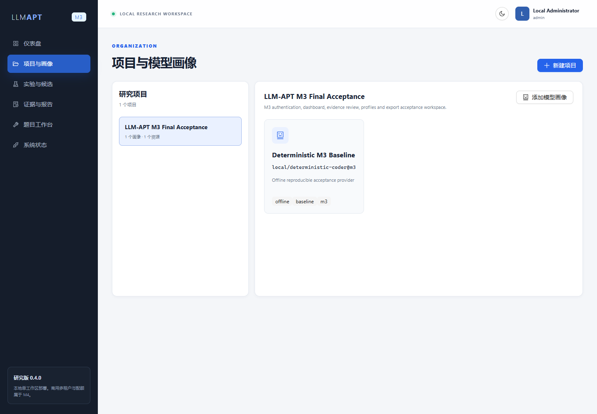

# M3 Final Acceptance Record

- Acceptance ID: `M3-0.4.0-FINAL-20260721`
- Date: 2026-07-21 (Asia/Shanghai)
- Scope: final open-source local research preview
- Result: **PASS**

## Static and automated quality gates

| Gate | Actual result | Verdict |
|---|---:|---|
| Ruff lint | all checks passed | PASS |
| Ruff format | 117 files already formatted | PASS |
| strict MyPy | 76 source files, 0 errors | PASS |
| Python tests | 120 passed | PASS |
| Python coverage | 82.86%, threshold 80% | PASS |
| ESLint | 0 errors, 0 warnings | PASS |
| TypeScript | strict build, 0 errors | PASS |
| Frontend tests | 4 files, 9 tests passed | PASS |
| Vite production build | success; largest lazy/shared chunk 429.29 kB | PASS |
| Compose validation | configuration valid | PASS |

The Python run reports one upstream Starlette/httpx deprecation notice. It is not an application
failure and is recorded for dependency maintenance.

## Deployment and persistence

| Check | Actual result | Verdict |
|---|---|---|
| Docker Compose services | 8/8 healthy | PASS |
| Alembic | `20260721_0004 (head)` | PASS |
| API version | `0.4.0` | PASS |
| Website | HTTP 200 at `http://localhost:3000` | PASS |
| Login | local admin bearer session issued and `/auth/me` verified | PASS |
| Report export | Markdown, HTTP 200, 463 bytes | PASS |

## M3 functional acceptance

| Capability | Evidence | Verdict |
|---|---|---|
| Authentication | PBKDF2 password verification, signed expiring bearer token | PASS |
| Role-aware review | admin/reviewer bearer principals accepted; legacy shared review token removed | PASS |
| Guest boundary | temporary guest can create an owned project; external generation returns 403 | PASS |
| Projects | create/list/detail and persistent PostgreSQL record | PASS |
| Resource organization | existing report linked to a project without rewriting evidence | PASS |
| Model profiles | provider/model/revision/tags persisted and rendered | PASS |
| Dashboard | project, profile, experiment, candidate, report and verdict aggregates rendered | PASS |
| Evidence review | three persisted public reports listed; detail view available | PASS |
| Report export | JSON, Markdown and CSV implementations available | PASS |
| Browser path | login → dashboard → projects → evidence completed headlessly | PASS |
| Responsive website | restrained desktop layout plus tablet/mobile breakpoints | PASS |

## Persisted acceptance identifiers

- Project ID: `3e470204-db17-44b8-b49a-363fe0fc4b4e`
- Linked M2 report ID: `4f426c9f-61bc-4bc7-a7ef-7d8b480a87d6`
- Browser result: project visible; 3 evidence rows; 0 page errors

At acceptance time the dashboard contained 1 project, 1 model profile, 1 experiment, 6 mutation
candidates, 3 evidence reports, and 3 stable failures. These values describe the local acceptance
database only; they are not statistical claims about external commercial models.

## Code scale

- Production Python: 76 files, approximately 5,580 lines.
- Python tests: 34 files, approximately 1,904 lines.
- Frontend TypeScript/TSX/CSS: 21 files, approximately 1,405 lines.

## Explicit boundary

M3 is complete for a single local research workspace. M4 commercial hardening—multi-tenancy,
quotas, billing, enterprise SSO, per-job gVisor, Kubernetes, long-term audit retention, and public
service operations—is not implemented and remains future work.

The 2026-07-22 hardening rerun additionally verified randomized local secrets, login throttling,
guest/project isolation, production default-secret rejection, eight healthy services, normal C++
execution (`42`) and memory-limit classification (`memory_exceeded=true`).

## Visual evidence

